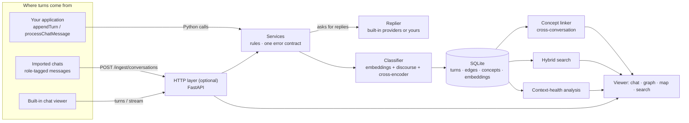

# How It Works

How turns are classified, how concepts are linked across conversations, what is stored, and how search and context-loss detection work.

[← Back to the README](../README.md)

## Architecture

## What It Does

For each new turn, the system decides whether it is:

- a `continuation` of an existing topic
- a `branch` off a previous answer or subthread
- `related` to one or more prior topics
- effectively unrelated, in which case it starts a new root thread

The result is stored as:

- conversation records
- turns
- semantic edges
- concept assignments
- concept links across conversations
- embeddings

and rendered as a chat with a graph drawer.

Separately, once a turn lands or a conversation is re-analyzed, every concept in
that conversation is scored against the concepts of every *other* conversation.
Close pairs become `conceptLinks`, surfaced in the drawer as "also discussed
elsewhere" and over `GET /concepts/graph`.

Response generation is pluggable. By default a *replier* routes to a stub, a
local `Ollama` model, `OpenAI`, `Anthropic`, or `Gemini`: the environment sets
the default and the UI and API can override it per conversation. Each request
carries the earlier turns that fit the context window, so a reply can see the
conversation. Ollama, OpenAI, and Anthropic support native incremental
streaming; Gemini currently falls back to one response chunk. A host with its
own model layer plugs in its own replier, or skips generation and records
finished turns with `appendTurn`.

## Core Approach

### Immediate Previous Turn

The immediate previous turn gets the strongest classifier. It combines three
signal sources:

- **embedding similarity** — `all-MiniLM-L6-v2` cosine between the new user
  message and the previous turn (`user + " " + ai`)
- **discourse features** — regex pattern families (clarification, reference,
  bare pronoun, forward / "how do I", comparison, lateral shift) plus lexical
  and content-term overlap
- **cross-encoder scores** — `cross-encoder/ms-marco-MiniLM-L-6-v2` run once
  per candidate label with a label-specific prompt

Discourse features decide which labels are *eligible*; the embedding and
cross-encoder signals set the confidence. A label is only scored when
something anchors it to the previous turn:

- `branch` — a clarification / reference / pronoun cue **with** a trace of
  shared topic under it (so a bare "why …?" after a hard topic switch is not a
  branch off nothing), or a confident cross-encoder `branch` score (the new
  question is answerable straight from the last answer)
- `continuation` — a "how do I … next" marker on an established topic, a
  comparison follow-up, a bare pronoun pointing back, or the message just
  staying on topic (high raw similarity to the turn or its answer) with no
  lateral-shift marker
- `related` — a "what about X instead" lateral shift, two parallel `what is X`
  questions about the same area, or real surface anchoring (shared content
  terms plus topic overlap) without a shift marker

Each eligible label's confidence blends its heuristic score, its cross-encoder
score, and the embedding similarities. The highest wins if it clears
`edgeConfidenceThreshold` (0.45); otherwise the turn gets **no edge** and
starts a new root.

`eval_immediate_previous.py` (driven by `eval_cases.json`) grades this on 27
cases across the four outcomes, plus 3 `knownGap` cases the bi-encoder can't
resolve — anaphora with no shared terms, acronyms it doesn't know — which are
reported but not graded.

### Older Prior Turns

Older-turn linking uses batched vector retrieval first, then classification.

Current flow:

1. score earlier turn embeddings in one NumPy matrix operation, minus a small
   decay for older turns
2. keep only the top few candidates
3. classify each selected older link as `continuation` or `related`

At this scale a direct scan is cheap and avoids the concept-centroid layer,
whose average embedding is a poor representative once a concept has drifted.

### Cross-Conversation Concept Links

A concept is the set of turns that share a `conceptId` inside one conversation.
`conceptIndex.py` compares concepts *across* conversations:

1. group every turn embedding by `(conversationId, conceptId)` and L2-normalise
2. score two concepts as the mean of the top-3 pairwise cosine similarities
   between their member turns — top-k, not max (one stray turn pair should not
   forge a link) and not the full mean (which dilutes a broad concept)
3. use normalized concept centroids to shortlist candidate pairs, then apply
   exact top-3 member scoring; `>= 0.66` is a `same` link, `>= 0.52` is
   `related`; cap 3 links per concept
4. concepts with no turn of at least four distinct word tokens are skipped, so
   greetings and acknowledgements do not link

`conceptId`s are reassigned from zero on every re-analysis, so each concept
also carries a stable `conceptKey` (`turnConcepts.conceptKey`): a re-analysed
concept inherits the key of the old concept it overlaps most (Jaccard >= 0.5,
matched greedily), and anything new gets a fresh key. `conceptLinks` is keyed
by this pair of `conceptKey`s, not by `(conversationId, conceptId)` — so a link
keeps pointing at the same concept across re-analysis. `auto` links are still
deleted and rebuilt on every change — debounced on the send path, forced on
re-analysis. A `manual` link (`POST /concept-links`) is left alone by that
rebuild and only disappears if one of its two concepts stops existing (a
concept that did not survive re-analysis, or its conversation was deleted) —
`pruneOrphanConceptLinks` runs in both of those transactions.
Thresholds were tuned against `eval_concept_links.py`: with
`all-MiniLM-L6-v2` on short questions, "same topic, different wording" pairs
land around 0.55-0.65 while the nearest false positives sit below 0.48.
Genuinely adjacent topics the model cannot lift out of the noise floor stay
unlinked by design.

**Tried and rejected: blending in the cross-encoder.** The immediate-turn
classifier gets real value from `cross-encoder/ms-marco-MiniLM-L-6-v2` (see [Immediate Previous Turn](#immediate-previous-turn) above), so it seemed worth trying for concept
scoring too. Measured against the same pairs `eval_concept_links.py`'s
thresholds were tuned on (full questions and short label-style text alike): it
reproduces cosine's
top-3 ranking almost exactly (0.65-0.96) and returns ~0.000 for every other
pair — including the ones cosine alone can't separate from noise, like
"train a neural network" vs. "overfitting in machine learning" (0.239
cosine, 0.00003 cross-encoder) or "REST API design" vs. "GraphQL API design"
(0.405 cosine, 0.012 cross-encoder). It's a query-passage reranker; two full
questions from unrelated conversations aren't the (short query, passage)
shape it was trained on, so it just strongly confirms whatever cosine was
already confident about and adds no signal in the gray zone — not worth the
extra model call per candidate pair.

Each concept is labelled by its most distinctive terms — term frequency
(across the concept's own turns) times inverse concept frequency (rarer
across the workspace scores higher), using a label-specific stopword list
(`conceptIndex._labelStopwords`, broader than the classifier's own) — rather
than by its first question verbatim, so "python, decorator" instead of "how
do decorators work in python". A concept with no content terms at all (a
greeting) falls back to that trimmed first question.

### Important Design Principle

Topic identity should dominate continuation decisions.

Discourse features are used as supporting evidence, not as ground truth. This reduces false positives where generic follow-up phrasing looks like continuation even when the topic changed.

## Persistence Model

Everything is saved locally in `.data/conversationTree.db` (`SQLite`, WAL mode)
by default, relative to the directory you start the app from (the server logs
the path it chose). Set `AI_CONVERSATION_TREE_DB` to choose another path. Runtime data
is ignored by Git; the old root-level `conversationTree.db` is retained only
as a legacy sample database.

- `conversations` — `model` column holds the conversation's default response
  model (`stub`, or `provider:model` such as `ollama:<name>`,
  `openai:<name>`, `anthropic:<name>`, `gemini:<name>`); null means use the
  replier's default. Imported chats also carry `source` (`chatgpt` /
  `claude` / `gemini` / `other`), `externalId` (the origin system's own
  conversation id), and `sourceUrl`; `(source, externalId)` is unique, which is
  how a re-sync finds its conversation
- `turns`
- `semanticEdges` — each edge carries an `origin` of `auto` (classifier) or `manual` (hand-created via `POST /edges`)
- `turnConcepts` — `conceptKey` is a stable per-concept identity carried across
  re-analysis by turn overlap; the integer `conceptId` is only a within-
  conversation label
- `conceptLinks` — similarity links between two `conceptKey`s in *different*
  conversations; the pair is stored once in a canonical order (no FK — a
  key's rows live in `turnConcepts`; `pruneOrphanConceptLinks` deletes a link
  once either key no longer exists), with an `origin` of `auto` (rebuilt on
  every change) or `manual` (hand-created via `POST /concept-links`)
- `turnEmbeddings` — one `float32` vector per turn, stored as a `BLOB`
  (`np.frombuffer` / `.tobytes()`), not JSON text

The first request for a conversation rebuilds its in-memory `ConversationGraph`
from persisted rows; `graphStore` then keeps it cached. Each cache entry carries
the conversation's SQLite `updatedAt` version and is reloaded when another
backend process changes that conversation, so multiple workers do not retain
stale graph state. A turn is written in one SQLite transaction (turn,
embedding, classifier edges, concept memberships — all or nothing), and if a
mutation fails part-way the cached graph is discarded and reloaded from SQLite,
so memory never holds a turn the database doesn't. Because every write bumps
`updatedAt`, the next request after a write reloads the graph; that is
deliberate, as it is what keeps other workers from serving stale state.

## Search

`GET /search` (`Cmd/Ctrl+K` in the viewer) is hybrid: embedding cosine finds
turns that mean the same thing in different words; a lexical pass rewards turns
containing the query's own words, so exact phrases and identifiers are found
too. Question hits get a small boost over answer hits.

The viewer groups hits by conversation (with the source badge), labels each as
a question or answer match with its position ("turn 3 of 7"), shows a snippet
around the match with the words highlighted, and can scope to the current chat.
`↑`/`↓` move through results, `Enter` opens the conversation and scrolls to the
exact turn.

## Context-Loss Detection

Long chats fail quietly: the model stops seeing something said fifty turns ago.
`contextService.py` looks for the tells in the conversation's own structure —
deterministic, no model call:

| Signal | Fires when | Weight |
| --- | --- | --- |
| `reask` | the user repeats an earlier question (embedding cosine ≥ 0.80, ≥ 0.90 for the immediately preceding turn) | 0.50 |
| `memoryCue` | the user points back: "as I said", "you forgot", "remember that…", "go back to…" | 0.45 |
| `farReach` | a turn is semantically tied to one ≥ 4 turns back **and** the text between them exceeds the context window | 0.60 |
| `longRange` | same, but still inside the window | 0.25 |

A turn's score combines its signals as `1 − Π(1 − w)`; ≥ 0.60 is `high`, ≥ 0.35
`medium`. The conversation gets an overall verdict, a token estimate
(characters ÷ 4) against the assumed window, and a *horizon*: the earliest turn
that still fits in the window counting back from the newest one. The transcript
draws a dashed line there and an amber note under each flagged turn; the
Summary panel lists them, each one click from the turn.

The window defaults to 8,000 tokens and is set with
`AI_CONVERSATION_TREE_CONTEXT_TOKENS`. It is an assumption about how much a
model attends to well, not a measurement of any particular model, and these
signals indicate *risk*, not proof — a repeated question can be deliberate.

The same window decides how much earlier conversation the built-in model
providers are sent with each new message (see [Using It As A Library](library.md)),
so the horizon marks where a model actually stops seeing the chat.
